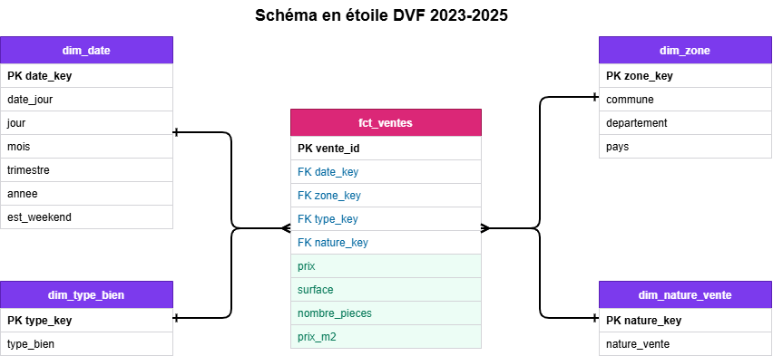
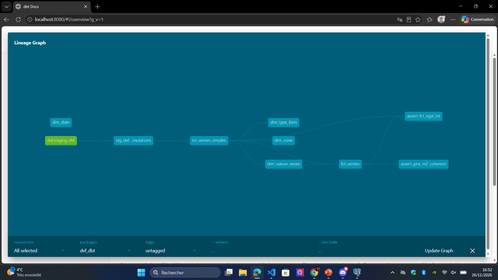
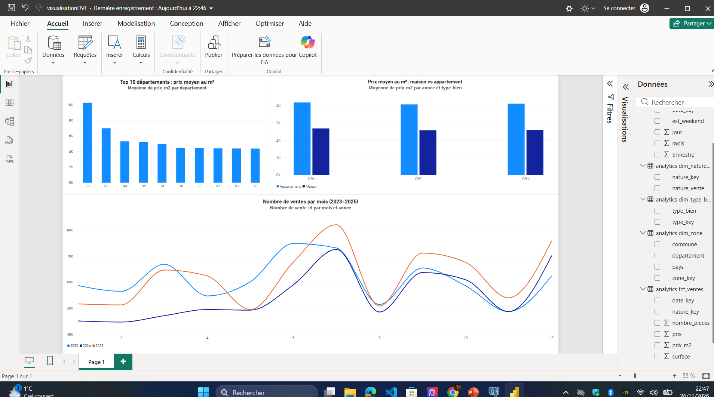

# Projet DVF : pipeline SQL / dbt et schéma en étoile

Projet du module *Ingénierie des données et pipelines SQL* (Ynov, Mastère 1 Data Engineer).

## Question métier
Comment évoluent les prix au m² des maisons et des appartements selon la zone et la période (2023-2025) ?

## Source des données
- **Demandes de valeurs foncières (DVF)**, data.gouv.fr
- Période : 2023 à 2025
- Licence : Licence Ouverte 2.0

## Stack
PostgreSQL 18 · pgAdmin 4 · dbt (dbt-postgres) · Power BI · Git/GitHub

## Architecture
CSV DVF → table `staging_dvf` (tout en TEXT) → dbt :
`staging` (typage, nettoyage) → `intermediate` (ventes d'un seul logement, valeurs aberrantes filtrées) → `marts` (schéma en étoile)

- **Grain** : une ligne de `fct_ventes` = une vente d'un seul logement (maison ou appartement)
- **Table de faits** : `fct_ventes` (prix, surface, nombre_pieces, prix_m2)
- **Dimensions** : `dim_date`, `dim_zone`, `dim_type_bien`, `dim_nature_vente`

## Lancer le projet
Prérequis : PostgreSQL avec la table `staging_dvf` chargée (scripts dans `sql/`), dbt installé, profil `dvf_dbt` configuré.

    cd dvf_dbt
    dbt build
    dbt docs generate
    dbt docs serve

`dbt build` exécute les 7 modèles et les 26 tests.

## Résultats
- 2 139 965 ventes retenues sur environ 11 millions de lignes
- Appartement : environ 4 100 €/m², maison : environ 2 600 €/m²
- Paris (75) avec 10 255,42 €/m²
- Pic de ventes en juillet, creux en août

## Contenu du dépôt
- `sql/` : staging, tables, remplissage, qualité, analyses (window functions, CTE récursive, index), questions métier
- `dvf_dbt/` : projet dbt (modèles, tests)
- `docs/` : schémas et captures

## Limites et pistes d'amélioration
- Les ventes multi-logements sont exclues (une ligne par vente)
- Seuils d'exclusion des valeurs aberrantes fixés à la main (500 à 30 000 €/m²)
- Dimension zone limitée à la commune
- Reconstruction complète à chaque exécution : passer en modèles `incremental`
- Pas d'orchestration ni d'intégration continue